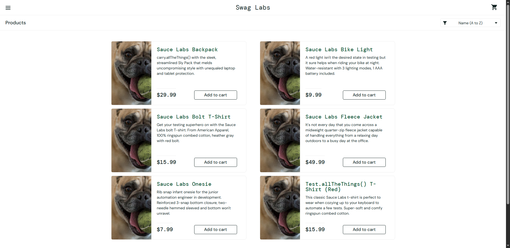
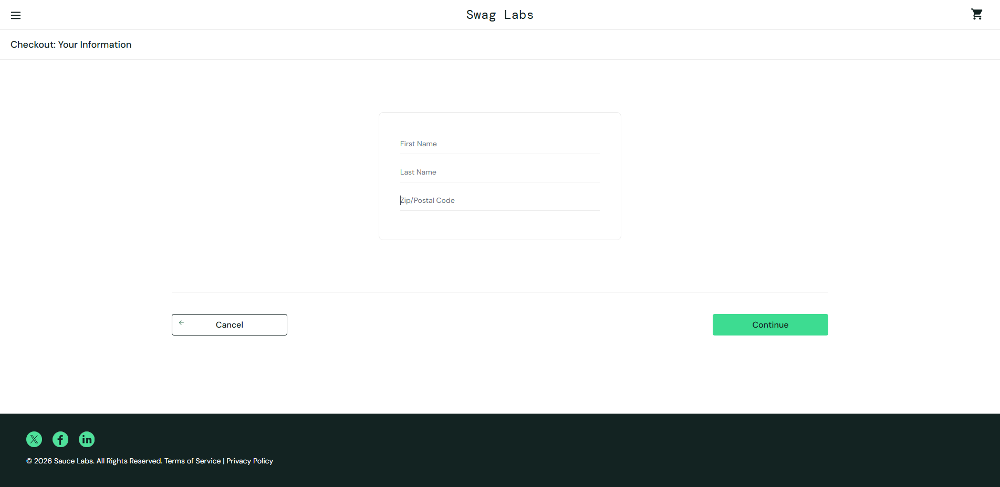
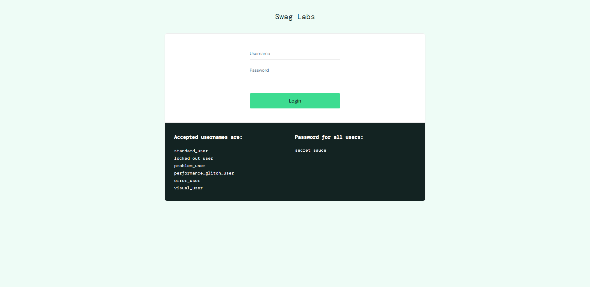

# Bug Reports: SauceDemo Target Application

**Target URL:** [https://www.saucedemo.com/](https://www.saucedemo.com/)  
**Reported By:** Vishwa Vijay Kumar  
**Date:** 21-Nov-2026  
**Environment:** Production Web Application (Google Chrome v133, Windows 11)  

---

## Bug 1: All Product Images Fail to Render and Default to 404 Dog Image (`problem_user`)

* **Bug ID:** BUG-001
* **Linked Test Case:** TC_BUG_01
* **Title:** Product catalog displays identical broken dog image (`sl-404`) for all items when logged in as `problem_user`
* **Severity:** High
* **Priority:** P1 (Urgent)
* **Status:** Open
* **Module:** Inventory / Product Catalog
* **Environment:** Desktop Chrome 133.0 / Windows 11

### Steps to Reproduce:
1. Navigate to `https://www.saucedemo.com/`.
2. Enter Username: `problem_user`.
3. Enter Password: `secret_sauce`.
4. Click "Login".
5. Observe the product catalog on `/inventory.html`.

### Expected Result:
Each product should render its distinct, high-resolution product photograph (e.g. Sauce Labs Backpack photo for the backpack, Bike Light photo for the bike light).

### Actual Result:
Every product in the catalog displays the exact same dog placeholder image sourced from `/static/media/sl-404.168b1cce.jpg`. The visual presentation is completely broken, preventing users from viewing the items they intend to purchase.

### Screenshot Evidence:

---

## Bug 2: Last Name Field Cannot Be Populated, Blocking Checkout Completion (`problem_user`)

* **Bug ID:** BUG-002
* **Linked Test Case:** TC_BUG_02
* **Title:** User cannot complete checkout as Last Name input field does not accept input / triggers validation error
* **Severity:** Critical (Showstopper)
* **Priority:** P1 (Urgent)
* **Status:** Open
* **Module:** Checkout (`/checkout-step-one.html`)
* **Environment:** Desktop Chrome 133.0 / Windows 11

### Steps to Reproduce:
1. Log in with `problem_user` / `secret_sauce`.
2. Add any item to the cart (e.g. Sauce Labs Backpack).
3. Open shopping cart and click "Checkout".
4. On `/checkout-step-one.html`, type `John` in First Name field.
5. Attempt to type `Doe` in the Last Name field (`#last-name`).
6. Enter Postal Code: `12345`.
7. Click "Continue" button.

### Expected Result:
The Last Name input field should accept and display text ("Doe"). Clicking "Continue" should transition the user to `/checkout-step-two.html` (Overview).

### Actual Result:
The Last Name field fails to retain user input or locks. Clicking "Continue" displays an error banner: *"Error: Last Name is required"*. The user is permanently blocked from proceeding to checkout step two and completing their order.

### Screenshot Evidence:

---

## Bug 3: Legitimate Registered User Locked Out Without Account Recovery Option (`locked_out_user`)

* **Bug ID:** BUG-003
* **Linked Test Case:** TC_AUTH_02
* **Title:** Locked out user account is blocked at login with no recovery or support action available
* **Severity:** Medium
* **Priority:** P2
* **Status:** Open
* **Module:** Authentication (`/`)
* **Environment:** Desktop Chrome 133.0 / Windows 11

### Steps to Reproduce:
1. Navigate to `https://www.saucedemo.com/`.
2. Enter Username: `locked_out_user`.
3. Enter Password: `secret_sauce`.
4. Click "Login".

### Expected Result:
If an account is suspended or locked, the UI should provide a descriptive error message alongside a support contact link or password reset / account recovery path.

### Actual Result:
System displays: *"Epic sadface: Sorry, this user has been locked out."* with no hyperlinks, recovery options, or guidance on how the user can resolve the suspension.

### Screenshot Evidence:

